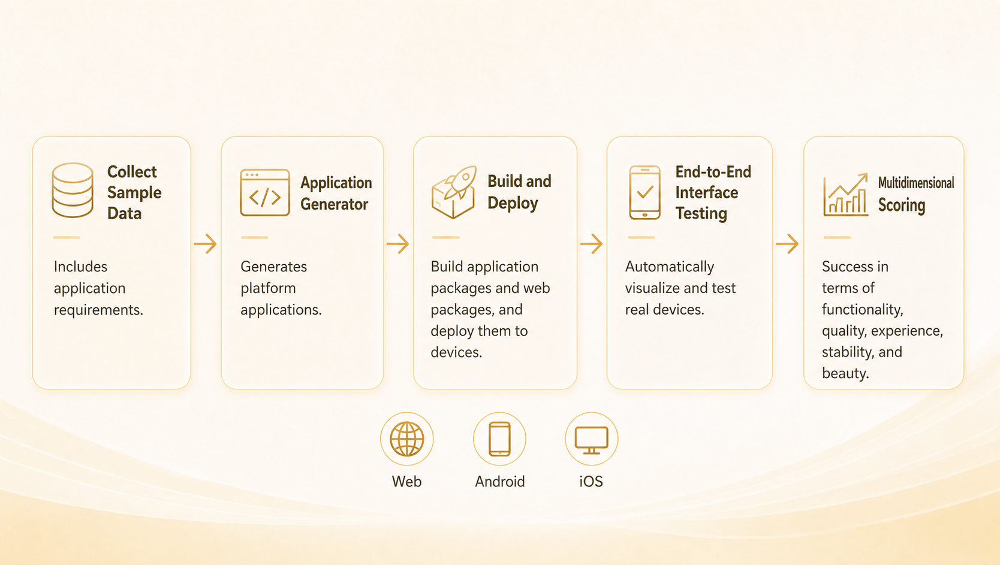
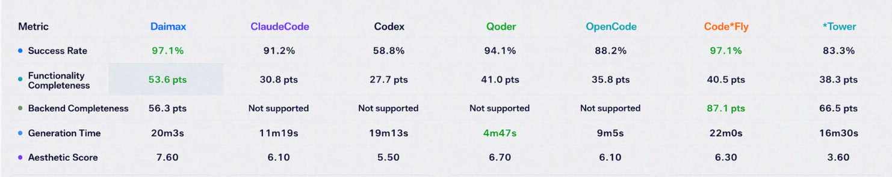

<div align="center">

# daimax-appbench

**An open-source benchmark for AI-generated applications, with fast URL quality checks and a full build, install, E2E testing and scoring pipeline. Built-in rules, sample datasets and layered test cases produce evidence-backed results and shareable reports.**

[](LICENSE)
[](https://python.org)
[](#supported-platforms)

[**QuickCheck**](#quickcheck) · [**Full Evaluation Quick Start**](docs/QuickStart.md) · [**API Reference**](docs/API.md) · [**Architecture**](docs/Architecture.md) · [**Contributing**](CONTRIBUTING.md) · [**DAIMAX Website**](https://www.daimax.cn/)

English | [中文](README.zh-CN.md)

<a href="https://star-history.com/#open-daimax/daimax-appbench&Date">
 <picture>
   <source media="(prefers-color-scheme: dark)" srcset="https://api.star-history.com/svg?repos=open-daimax/daimax-appbench&type=Date&theme=dark" />
   <source media="(prefers-color-scheme: light)" srcset="https://api.star-history.com/svg?repos=open-daimax/daimax-appbench&type=Date" />
   
 </picture>
</a>

</div>

<div align="center">

</div>

---

## What is daimax-appbench?

**daimax-appbench** is an open-source benchmark platform for AI-generated applications, with two complementary evaluation paths:

- **QuickCheck**: submit a deployed Web URL to inspect mobile/desktop first screens, quality scores and specific visible issues.
- **Full evaluation**: supply a requirement sample and an artifact (URL, Android APK, iOS `.app`, source project or workspace) to run **build → install → E2E tests → multi-dimensional scoring → report**, validating requirements and test cases.

Models are configured by the user. Visual models provide evidence-based judgments while code calculates scores, and compatible model services can be substituted.

> Full evaluation, datasets, rules, E2E orchestration and reports are already open source. QuickCheck is the source addition in this update; older tags or release packages may not include it. Runtime operation does not require internal repositories or company services; bring your own model endpoint.

---

## Key Features

- **Application quick checks** — bounded page-readiness checks with dual-viewport screenshots, evidence-backed quality scores and a local UI; complements the full E2E benchmark
- **End-to-end pipeline** — build, install, E2E testing, scoring, and reporting in a single command, with zero manual intervention
- **AI-powered E2E testing** — a vision model executes atomic test steps and replans on the fly when the UI diverges from expectations
- **Full-evaluation reports** — double-click to open, no server required; total-score cards, per-platform metrics, and per-sample details in one portable file
- **Curated sample datasets** — V1 (basic regression) and V2 (full-feature evaluation), organized by generation → category → sample
- **Zero-config artifact evaluation** — pass a URL, APK, or `.app` and get a score immediately, with no knowledge of the internal workspace layout
- **Pluggable architecture** — register custom generators and CLI subcommands via entry points without touching the core

---

## Choose an evaluation path

Use QuickCheck to inspect visible page quality quickly; use full evaluation to validate requirements and user flows. The rubrics differ, so their total scores are not directly comparable.

| | QuickCheck | Full evaluation |
|---|---|---|
| Entry point | `evalapp quickcheck`, `evalapp quickcheck-ui` | `evalapp evaluate` |
| Input | Deployed Web URL | URL, APK, iOS `.app`, source project, or an existing workspace |
| Scope | Dual-viewport first screens and observed loading/runtime evidence | Sample-driven E2E steps and assertions; build/install when applicable |
| Questions answered | Is the loaded page usable, well presented and adapted? What visible problems need attention? | Does the app implement the sample requirements and pass its test cases? |
| Output | Screenshots, observations, score ledger, JSON results, local review UI | Workspace results, logs, screenshots and portable `report.html` |
| Budget | Default 120-second total budget, including queued time; incomplete results remain explicit | Depends on the samples, platforms and configured pipeline |

---

<a id="quickcheck"></a>

## QuickCheck: application quick checks

Paste a deployed Web URL to capture mobile and desktop views, inspect ten quality submetrics, and review the score beside screenshots and deduction reasons.

These are **real archived evaluations**, with project names, identifiers and links anonymized. All three used `qwen3.8-flash` and `hierarchical-v8.1`; scores and reported run times are unchanged. The higher example is relative to this set, **not an “excellent” grade**. These examples illustrate report behavior, not a model ranking or a latency guarantee.

| Example | Overall | Visual | Information | Adaptation |
|---|---:|---:|---:|---:|
| A · Lower | 48.0 | 45.0 | 60.0 | 40.0 |
| B · Medium | 62.6 | 59.0 | 70.0 | 60.0 |
| C · Relatively higher | 72.2 | 75.5 | 70.0 | 70.0 |

<details>
<summary>Lower-score example · 48.0 · expand screenshot</summary>


</details>

<details open>
<summary>Medium-score example · 62.6 · expand screenshot</summary>


</details>

<details>
<summary>Relatively higher-score example · 72.2 · expand screenshot</summary>


</details>

### What does QuickCheck inspect?

| Group | Supported submetrics | Evidence and scoring |
|---|---|---|
| **Visual & experience design · 40%** | Composition/layout, typography, colors/assets, component details, creative/scene expression | Model judgments grounded in the captured views; explicit issues and quality ratings feed deterministic scoring |
| **Information · 30%** | Purpose/task efficiency, information organization, action guidance | Visible task entry points, hierarchy, labels and next-step cues |
| **Device adaptation · 30%** | Mobile layout and desktop layout | Dual-viewport evidence; measured clipping/overflow belongs to its device and is not deducted again from visual quality |
| **Page access & runtime** | Opening, blank/persistent loading, script exceptions and failed resources | Browser observations; runtime loss reduces the quality score rather than adding another positive weight |
| **Visible-content checks** | Explicit sexual content, real-money gambling promotion and drug promotion | Evidence-backed violations trigger the configured redline; unknown remains unknown |

Default formula: quality base = visual×40% + information×30% + adaptation×30%; overall = max(0, base − runtime loss×20%). Confirmed redlines may force zero. Unknown evidence does not become a passing result. See the [QuickCheck guide](docs/QuickCheck.md) for per-item weights, evidence boundaries and examples.

### Choose your vision model

QuickCheck is not tied to a model or provider. Set the model name, API base URL and credentials in YAML or the local UI, using a compatible service that supports image input and the required JSON response protocol. **`qwen3.8-flash`** is a recommended starting point: it provided a useful balance of quality, speed and cost in our examples.

Reference experience: **about 30 seconds and ¥0.013 per evaluation (1.3 Chinese fen)**. These are project-provided example timings and a cost estimate, not a fixed quote or latency guarantee. Page complexity, model response time, cache state, token usage, completion requests and provider billing can change the actual figures.

### Install and run

Install the optional browser dependencies:

```bash
pip install -e '.[quickcheck]'
python -m playwright install chromium
cp evalapp.yaml.example evalapp.yaml
```

Set an OpenAI-compatible vision model in `evalapp.yaml` (already git-ignored). The model, endpoint and scoring rules are configurable; the local UI can save model preferences without returning existing keys to the browser.

```yaml
workspace_root: ~/eval_app_factory
quickcheck:
  model:
    name: qwen3.8-flash # replace with a vision model available from your provider
    base_url: https://your-gateway.example/v1
    api_key_env: QUICKCHECK_API_KEY
    request_options: {temperature: 0, max_tokens: 8000}
      # enable_thinking: false  # only if supported by your provider
  model_concurrency: 5
  deadline_seconds: 120
```

```bash
# Supply QUICKCHECK_API_KEY in your environment, then evaluate a page:
evalapp quickcheck --url https://example.com --name example

# Local review UI; use any free port:
evalapp quickcheck-ui --port 8766
```

The checked-in single-file UI is ready to run: `./scripts/start-quickcheck.sh` serves it with the API and does not require Node.js. To rebuild after changing frontend source, use `QUICKCHECK_BUILD_UI=1 ./scripts/start-quickcheck.sh` (Node.js required). On Linux, install browser system dependencies with `python -m playwright install --with-deps chromium`. See the [QuickCheck guide](docs/QuickCheck.md) for the scoring formula, configuration, one-time missing-field completion and evidence boundaries. A clean content check covers only the visible evidence, not the whole site or legal compliance.

---

## Full Evaluation Report

Every full-evaluation run produces a single, self-contained HTML report that scores the generated app across multiple dimensions and lets you drill into each check:

<div align="center">

</div>

---

## Full Evaluation Dimensions

The following full-evaluation scores use a 0–100 scale. Weights, thresholds, and penalty coefficients are centrally defined as a single source of truth in `evalapp/evaluation/metrics/rules.py`.

| Dimension | What it measures | Source |
|---|---|---|
| **Success Rate** | First-time generation success rate (weight 60%) + issue-fix & requirement-extension rates (reserved, 20% each; dynamically normalized when absent) | Build / install / launch gating |
| **Functional Completeness** | Base score = E2E pass rate × 100, minus stability penalty (up to 20%) and backend penalty (up to 30%). Build/install/launch failure forces 0. | E2E results + device logs + network |
| **Experience** | Duration 60% + artifact size 20% + aesthetics 20% (missing sub-dimensions auto-normalized) | Stage timings + artifact size + screenshots |

**Functional Completeness sub-indicators** (not scored independently; feed into the dimension above):
- *Stability*: `max(0, 1 − issue_rate) × 100`, where issues = crash + ANR + white screen. Applied as a deduction factor (up to 20% of the base score).
- *Backend Completeness*: Applied as a deduction factor (up to 30% of the base score). Only active when the sample requires a backend; otherwise no deduction.

**Aesthetics** (20% weight within Experience) — VL-model scoring: Color Harmony 25% + Layout Quality 25% + Visual Hierarchy 20% + Typography 15% + Professionalism 15%. White-screen or load-failure pages are scored as 0 and folded into the weighted average.

> Full metric formulas and penalty models are documented in the [Architecture guide](docs/Architecture.md).

---

## Agent Leaderboard

Below are results measured with this framework across mainstream AI coding agents and app-generation platforms — identical evaluation rules, identical pipeline, zero human intervention:

<div align="center">

</div>

**What these metrics mean for an app**

| Metric | Why it matters | How to read it |
|---|---|---|
| **Success Rate** | The floor for shippability — if the build fails, the app won't install, or it crashes on launch, every other metric is moot | A pass/fail bar rather than a differentiator; every point lost means another batch of artifacts needing manual rescue |
| **Functionality Completeness** | How much of the requirement was actually implemented. An app that runs but is half-built is not done | The metric to weigh most heavily — it maps directly to "how much manual work is left after delivery" |
| **Backend Completeness** | Whether data actually persists and endpoints actually connect — the line between a demo and a usable product | Only products capable of generating a backend report this; a beautiful UI that can't save data is still just a prototype |
| **Generation Time** | Sets the iteration rhythm. A few minutes means you can retry and reshape requirements freely; past twenty it becomes "submit a job and wait" | Must be read alongside success rate and completeness — fast but flaky loses to slow but steady |
| **Aesthetic Score** | The first retention gate for consumer apps; users bounce within seconds over a rough-looking UI | Also determines whether the UI needs a rebuild after delivery |

> Success Rate and Functionality Completeness map to the same-named dimensions in [Full Evaluation Dimensions](#full-evaluation-dimensions) above. Backend Completeness is a deduction factor within Functional Completeness, while Generation Time and Aesthetics are components of the Experience dimension — they are broken out here for direct side-by-side comparison.

---

## Bring Your Own Agent

The evaluation framework ships no generator implementation of its own — **any agent or platform that can produce an app can be plugged in and measured**, closed-source commercial products included. Every entry in the leaderboard above was onboarded through one of the two paths below.

### Path 1: Evaluate artifacts directly (no code required)

Let your agent generate, then hand the artifact to the framework:

```bash
evalapp evaluate --url https://your-app.vercel.app        # Web
evalapp evaluate --apk ./your-app.apk                     # Android
evalapp evaluate --app ./YourApp.app                      # iOS
evalapp evaluate --project ./your-project --platform web   # Source project
```

Works with any agent and any tech stack — the framework only looks at the artifact, never at how it was produced.

### Path 2: Plug in as a generator (fully automated batch runs)

Implement the `AppGenerator` interface and let the framework drive your agent through the whole **generate → evaluate** loop, sweeping an entire benchmark suite in one command:

```python
import shutil
from evalapp.generators import AppGenerator, GenerationResult

class MyAgentGenerator(AppGenerator):
    name = "myagent"                       # non-empty name ⇒ auto-registered
    supported_platforms = ["web", "android"]

    def is_available(self) -> bool:
        return shutil.which("myagent-cli") is not None

    def generate(self, prompt_text, platform, session_id=None,
                 workspace_dir=None, constraints=None) -> GenerationResult:
        # Invoke your agent; produce a source project or a deployed URL
        return GenerationResult(
            success=True, platform=platform,
            project_path="/path/to/generated/project",  # source artifact
            h5_url="",                                   # or the deployed web URL
        )
```

Declare an entry point in your own package — it is discovered automatically after `pip install`, with **no changes to this repository**:

```toml
[project.entry-points."evalapp.generators"]
myagent = "my_pkg.generators:MyAgentGenerator"
```

Then run a batch evaluation against it:

```bash
evalapp evaluate --workspace ./ws --samples-dir ./dataset/V2 --platform web --generator myagent
```

Generators may optionally implement the `setup()` / `teardown()` / `validate_config()` / `resume()` lifecycle hooks. See the [API Reference](docs/API.md) for interface details.

---

## Supported Platforms

The benchmark evaluates three kinds of build artifacts, independent of how they were produced:

| Platform | Artifact type | Input |
|---|---|---|
| **Web** | Web artifact — mini-program, Expo Web, H5, or any deployed web app | Deployed URL (`--url`) |
| **Android** | Android artifact — APK | Prebuilt APK (`--apk`) |
| **iOS** | iOS artifact — `.app` bundle | Prebuilt `.app` (`--app`) |

Platform is inferred automatically from the artifact type; `--project` (source mode) requires an explicit `--platform`.

---

## Benchmark Suite

The project ships with two standardized benchmark suites (under `dataset/`). Every sample follows a unified **Requirement → Case → Step** format, making results reproducible and directly comparable:

| Version | Focus |
|---|---|
| **V1** | Baseline regression — classic categories (tools, games, social, lifestyle, etc.); broad coverage, ideal for fast regression |
| **V2** | Vertical depth — niche domains (beverage, collection, nature, knowledge, etc.); high complexity, most require backend & auth |

**Layered structure** — samples are organized across four levels: dataset → sample → case → step:

```
dataset/
└── sample/
    ├── sample.yaml                  # Requirement definition & metadata
    └── test_cases/
        └── test_cases_default.json  # Layered test cases
```

`sample.yaml` fully describes the requirement (`requirement` text, `core_functions`, `constraints`, `app_type`, plus metadata such as `requires_backend`/`requires_auth`/complexity).

Every sample is driven by structured test cases, keeping the evaluation transparent and auditable — cases are organized as **case → steps**, where each step is a natural-language "action → assertion" pair executed and verified by the vision model:

```json
{
  "id": "TC001",
  "name": "Main menu display",
  "priority": "P0",
  "steps": [
    "Launch the app and enter the main menu -> Expected: game title '2048' is displayed",
    "Check menu buttons -> Expected: [Start Game][Leaderboard][Settings] entries visible",
    "Check high score -> Expected: current high score shown at bottom (0 on first launch)"
  ],
  "expected_result": "Main menu displays title, functional buttons, and high score correctly"
}
```

Case priorities: `P0` (critical path, must pass), `P1` (important features), `P2` (edge cases).

**Bring your own benchmark** — the suite is fully open: use the same format to extend it or build a dedicated benchmark, whether for frontend-only apps, apps with a backend, or any specific category / app type. Any directory following the convention (sub-directories containing `sample.yaml`) can be evaluated directly, and new samples & categories are welcome via PR:

```bash
evalapp evaluate --workspace <workspace> --samples-dir /path/to/your-dataset --platform web
# Evaluate a specific category or specific samples
evalapp evaluate --samples-dir ./dataset/V2/beverage --platform android
evalapp evaluate --samples-dir ./dataset/V2 --sample-ids TeaCeremony,CoffeeRoastLog --platform web
```

---

## Full Evaluation Quick Start

**1. Install** — requires Python ≥ 3.10:

```bash
git clone https://github.com/open-daima/daimax-appbench.git
cd daimax-appbench
python -m venv .venv && source .venv/bin/activate
pip install -e .
```

The repository directory is `daimax-appbench`; the installed Python package and CLI command are both `evalapp`.

**2. Configure** — copy the example and fill in your model API keys:

```bash
cp evalapp.yaml.example evalapp.yaml
```

`evalapp.yaml` contains secrets and is already git-ignored — do not commit it.

**3. Run** — pass an artifact and get scored:

```bash
evalapp evaluate --url https://my-app.vercel.app --sample-ids CoffeeRoastLog
```

When the run finishes, a single-file `report.html` is written to the workspace root and opened in your browser (disable with `--no-open-report`).

> No app to evaluate yet? Describe your idea on [DAIMAX](https://www.daimax.cn/) and you'll have a runnable app in minutes — then point `--url` at it and see how it scores.

---

## Evaluation workspaces

New default outputs share `workspace_root` (default `~/eval_app_factory`) instead of creating result directories in the source checkout:

```text
~/eval_app_factory/
  quickcheck/          # QuickCheck cases, snapshots, policies and runs
  evaluations/         # Direct artifact full evaluation; report.html lives here
  <existing-workspace>/# Existing/custom benchmark workspaces remain unchanged
```

- `evalapp quickcheck --output /path/to/quickcheck` overrides the QuickCheck directory.
- `evalapp evaluate --url ... --sample-ids ... --output /path/to/full` overrides the direct-artifact directory.
- `evalapp evaluate --workspace /path/to/workspace ...` continues to use the explicit workspace. Sample-driven evaluation requires this path; `workspace_root` does not relocate generator source projects.
- To keep everything local to a checkout, set `workspace_root: ./workspaces`; `/workspaces/` is git-ignored. Relative paths are resolved from the command's working directory.

**Existing data is not moved automatically.** An existing `./quickcheck_output/` using `cases/snapshots/policies/runs` and a full-evaluation `./eval_output/` can still be selected with `--output` and remain git-ignored. Historical flat QuickCheck `qc_*` layouts and retired scoring workflows are not supported by the new core. To reopen an existing QuickCheck workspace, use `evalapp quickcheck-ui --output ./quickcheck_output --port 8766`, or `QUICKCHECK_OUTPUT=./quickcheck_output ./scripts/start-quickcheck.sh`. Do not delete snapshots while their historical results are still needed. Screenshots, URLs and model observations may contain private data; review/redact before sharing a workspace.

---

## CLI Overview

| Command | Description |
|---|---|
| `evalapp quickcheck` | Run a bounded application quality check for a Web URL |
| `evalapp quickcheck-ui` | Open the local QuickCheck UI and model settings |
| `evalapp evaluate` | Evaluate an artifact or source project (build → install → E2E → score → report) |
| `evalapp retest` | Re-run E2E tests and regenerate the report |
| `evalapp report` | Generate or regenerate the report for a completed run |
| `evalapp export` | Read-only, versioned JSON export for local data exchange |
| `evalapp history` | Show the execution history of a workspace |

See the [API Reference](docs/API.md) for the full option set of every command.

```bash
evalapp export --workspace ./workspace --output ./evaluation.json
```

Export keeps native snapshots, report-selected scores and retest observations separate, with source provenance and unknown execution states. It does not rescore or modify the workspace. Output must be outside the workspace; existing output requires `--overwrite`. JSON may contain free text and local paths: manually redact it before sharing. See the [v1 contract and Python APIs](docs/API.md#evalapp-export) for supported formats and best-effort consistency limits.

---

## Documentation

- [QuickCheck guide](docs/QuickCheck.md) — model settings, submetrics, evidence and artifacts
- [QuickCheck maintenance](docs/QuickCheck-Maintenance.md) — standalone-core sync workflow
- [Quick Start Guide](docs/QuickStart.md) · [快速开始](docs/QuickStart.zh-CN.md)
- [API Reference](docs/API.md) · [API 参考](docs/API.zh-CN.md)
- [Architecture](docs/Architecture.md) — pipeline, metric formulas, dataset & test-case design
- [Dataset Guide](dataset/README.md) — sample structure and execution plans

---

## Running Tests

```bash
pip install -e ".[dev]"
pytest
```

---

## Contributing

Contributions of all kinds are welcome — new metrics, dataset samples, platform support, documentation, and test coverage. Please read [CONTRIBUTING.md](CONTRIBUTING.md) for the workflow, code style, and PR checklist.

---

## About DAIMAX

daimax-appbench comes out of [DAIMAX](https://www.daimax.cn/), an AI-powered app factory: describe an app in natural language and the platform handles requirement breakdown, UI design, code generation, live preview, and iteration — delivering mini-programs, H5, and cross-platform apps.

This benchmark is how we keep our own generated apps honest. If that sounds useful, come try it at [www.daimax.cn](https://www.daimax.cn/).

---

## License

daimax-appbench is released under the [Apache License, Version 2.0](LICENSE).
