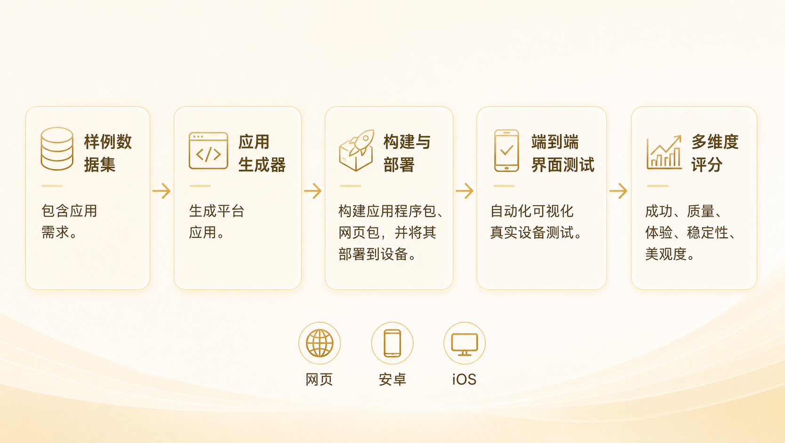
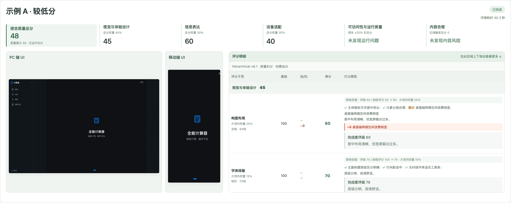
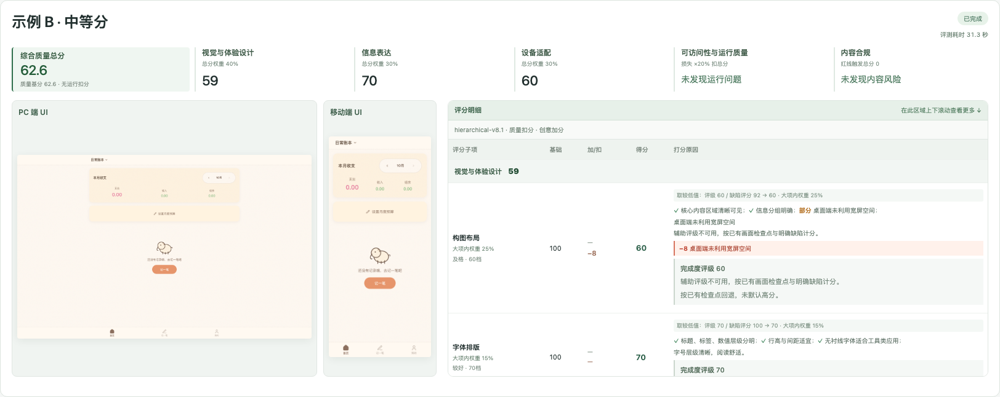
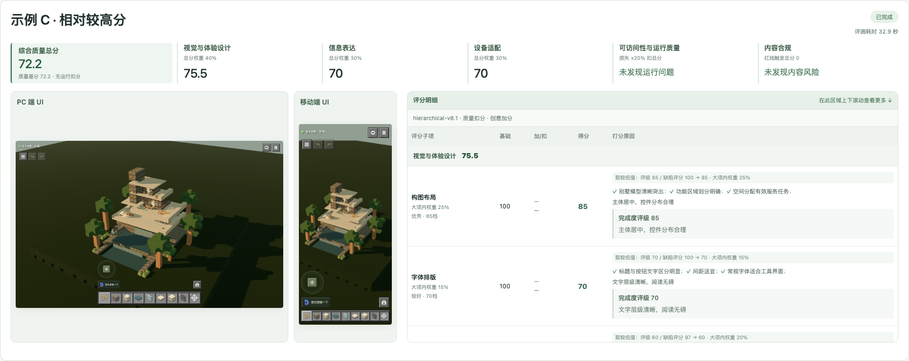
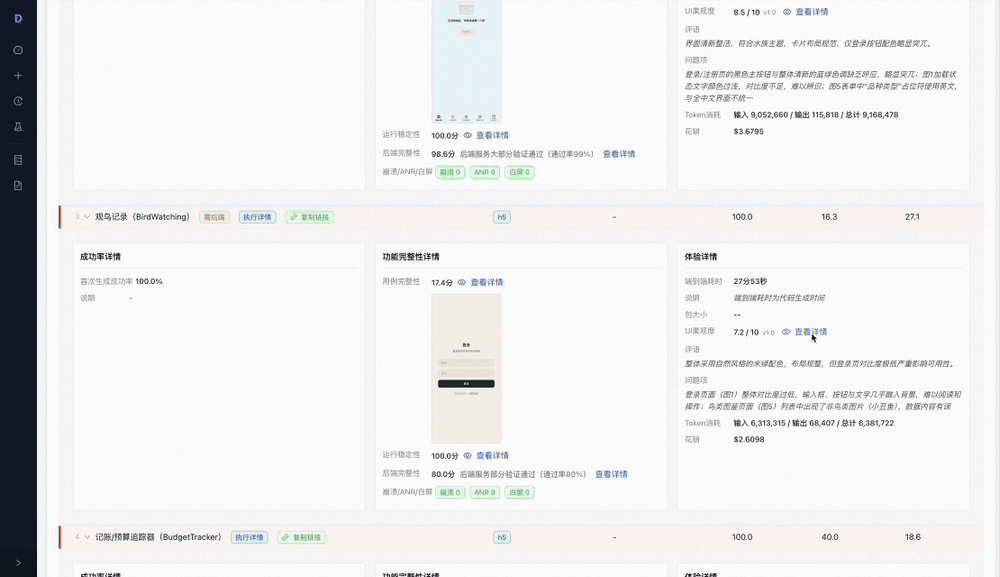
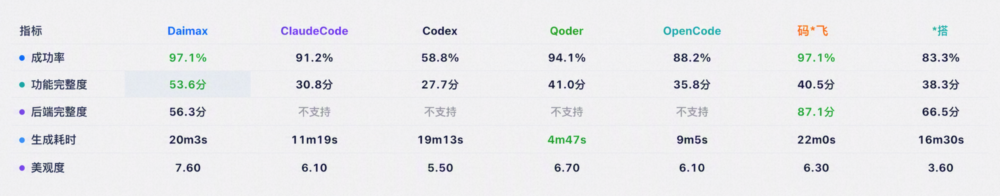

<div align="center">

# daimax-appbench

**面向 AI 生成应用的开源评测基准平台，同时提供链接快速评测与完整 E2E 流水线。内置评测规则、标准样本集与分层用例，自动完成构建、安装、测试与评分，产出可追溯结果和可分享报告。**

[](LICENSE)
[](https://python.org)
[](#支持平台)

[**快速评测**](#quickcheck) · [**完整评测入门**](docs/QuickStart.zh-CN.md) · [**API 参考**](docs/API.zh-CN.md) · [**架构**](docs/Architecture.md) · [**贡献指南**](CONTRIBUTING.md) · [**袋马官网**](https://www.daimax.cn/zh-CN)

[English](README.md) | 中文

<a href="https://star-history.com/#open-daimax/daimax-appbench&Date">
 <picture>
   <source media="(prefers-color-scheme: dark)" srcset="https://api.star-history.com/svg?repos=open-daimax/daimax-appbench&type=Date&theme=dark" />
   <source media="(prefers-color-scheme: light)" srcset="https://api.star-history.com/svg?repos=open-daimax/daimax-appbench&type=Date" />
   
 </picture>
</a>

</div>

<div align="center">

</div>

---

## 什么是 daimax-appbench？

**daimax-appbench** 是衡量 AI 生成应用质量的开源评测平台，提供两种互补的评测方式：

- **QuickCheck 快速评测**：输入已部署的 Web URL，查看双端首屏、质量评分和具体问题。
- **完整评测**：输入需求样本与应用产物（URL、Android APK、iOS `.app`、源码项目或工作区），执行 **构建 → 安装 → E2E 测试 → 多维度评分 → 报告**，验证需求与用例。

模型通过配置接入，视觉判断与确定性计分分工明确，可自行选择兼容的模型服务。

> 完整评测、数据集、规则、E2E 编排和报告已经开源；QuickCheck 是本次新增源码能力，历史 tag 或发布包不一定包含。运行不依赖内部仓库或公司服务，模型接口由使用者自行配置。

---

## 核心特性

- **应用快速检测 QuickCheck** — 等待页面就绪后采集双端画面，给出可追溯的质量评分和本地页面，与完整 E2E 基准互补
- **端到端流水线** — 构建、安装、E2E 测试、评分与报告一条命令跑完，全程零人工介入
- **AI 视觉驱动的 E2E 测试** — 视觉模型逐条执行原子化用例，当界面与预期不符时自动重规划
- **完整评测报告** — 双击即开，无需任何服务；总分卡片、分平台指标、逐样本明细集于一份可移动的文件
- **精选样本数据集** — V1（基础回归）与 V2（全功能评测），按代际 → 类别 → 样本三级组织
- **零配置产物评测** — 传入 URL、APK 或 `.app` 即可立即评分，无需了解内部工作区结构
- **插件化架构** — 通过 entry point 注册自定义生成器与 CLI 子命令，无需改动核心代码

---

## 选择评测方式

需要快速查看页面呈现时使用 QuickCheck；需要验收需求和用户流程时运行完整评测。两者评分口径不同，总分不能直接横比。

| | 应用快速检测 QuickCheck | 完整评测 |
|---|---|---|
| 命令 | `evalapp quickcheck`、`evalapp quickcheck-ui` | `evalapp evaluate` |
| 输入 | 已部署的 Web URL | URL、APK、iOS `.app`、源码项目或已有工作区 |
| 覆盖范围 | 双端首屏、观察窗口内的加载与运行证据 | 样本驱动的 E2E 步骤和断言；按输入类型执行构建、安装 |
| 适用问题 | 首屏是否好用、布局是否合理、双端是否适配、有哪些可见问题？ | 样本需求实现了多少、测试用例是否通过？ |
| 输出 | 截图、观察事实、计分账本、JSON 结果和本地评测页面 | 工作区结果、日志、截图及便携的 `report.html` |
| 时间 | 默认总预算120秒，包含排队；未完成项明确保留未知 | 取决于样本、平台和流水线配置 |

---

<a id="quickcheck"></a>

## QuickCheck：应用快速评测

粘贴已部署的 Web URL，即可采集手机与 PC 双端画面，检查十项质量子指标，并对照截图查看总分、完成度和具体扣分依据。

以下均为**真实历史评测结果**，仅将项目名、标识和链接匿名化，未修改分数或记录耗时。三例统一使用 `qwen3.8-flash`、`hierarchical-v8.1`；“相对较高”仅针对这组示例，**72.2 分不代表优秀档位**。示例用于说明报告与区分能力，不是模型排行榜，也不承诺每次达到相同耗时。

| 示例 | 综合分 | 视觉设计 | 信息表达 | 设备适配 |
|---|---:|---:|---:|---:|
| A · 较低分 | 48.0 | 45.0 | 60.0 | 40.0 |
| B · 中等分 | 62.6 | 59.0 | 70.0 | 60.0 |
| C · 相对较高分 | 72.2 | 75.5 | 70.0 | 70.0 |

### 较低分示例 · 48.0




### 中等分示例 · 62.6




### 相对较高分示例 · 72.2




### 快评支持哪些子指标？

| 大项 | 支持的子指标 | 证据与计分方式 |
|---|---|---|
| **视觉与体验设计 · 40%** | 构图布局、字体排版、配色与素材、控件细节、创意与场景表现 | 模型根据截图判断完成度与明确问题，由代码按规则计分 |
| **信息表达 · 30%** | 用途与任务效率、信息组织、操作指引 | 检查可见的任务入口、信息主次、标签语义和下一步线索 |
| **设备适配 · 30%** | 手机适配、桌面适配 | 双端证据与几何测量；裁切/溢出归对应设备，避免在视觉项重复扣分 |
| **页面可打开性与运行质量** | 页面打开、白屏/持续加载、脚本异常、资源请求失败 | 浏览器记录技术事实；运行损失扣减质量总分，不另加正向权重 |
| **可见内容检查** | 明确色情、现实赌博推广、毒品推广 | 有证据的违规触发对应红线；未知不当作通过 |

默认公式：质量基分 = 视觉×40% + 信息×30% + 适配×30%；总分 = max(0, 基分 − 运行损失×20%)。确认红线按规则归零，证据不足保留未知。子项权重、证据边界和示例来源见 [QuickCheck 使用说明](docs/QuickCheck.md)。

### 模型可自由选择

QuickCheck 不限定模型或服务商：可在 YAML 或本机页面填写模型名、API 地址与密钥，接入支持视觉输入和所需 JSON 响应协议的兼容服务。推荐先使用 **`qwen3.8-flash`**，在我们的样例中效果、速度与成本较均衡。

参考体验为 **约30秒/次、约1.3分钱（¥0.013）/次**。这是项目提供的样例与成本估算，不是固定报价或速度承诺；页面复杂度、模型响应、缓存、token 用量、补全次数与服务商实际计费都会影响结果。

### 安装与运行

安装可选浏览器依赖：

```bash
pip install -e '.[quickcheck]'
python -m playwright install chromium
cp evalapp.yaml.example evalapp.yaml
```

在已被 Git 忽略的 `evalapp.yaml` 配置 OpenAI 兼容视觉模型。模型、接口和评分规则均可配置；本地页面可保存模型设置，不会回显已有密钥。

```yaml
workspace_root: ~/eval_app_factory
quickcheck:
  model:
    name: qwen3.8-flash # 可替换为你的服务商提供的视觉模型
    base_url: https://your-gateway.example/v1
    api_key_env: QUICKCHECK_API_KEY
    request_options: {temperature: 0, max_tokens: 8000}
      # enable_thinking: false  # only if supported by your provider
  model_concurrency: 5
  deadline_seconds: 120
```

```bash
# 先通过环境变量设置 QUICKCHECK_API_KEY，然后评测页面：
evalapp quickcheck --url https://example.com --name 示例

# 打开本地评测页面，可改用其他空闲端口：
evalapp quickcheck-ui --port 8766
```

仓库已包含构建好的单文件页面，直接执行 `./scripts/start-quickcheck.sh` 即可启动同源页面和接口，运行不需要 Node.js。修改前端源码后，用 `QUICKCHECK_BUILD_UI=1 ./scripts/start-quickcheck.sh` 重新构建（需要 Node.js）。Linux 首次部署使用 `python -m playwright install --with-deps chromium` 安装浏览器系统依赖。评分公式、参数配置、一次缺项补全及证据范围见 [QuickCheck 使用说明](docs/QuickCheck.md)。内容检查通过只代表可见证据中未发现问题，不代表全站或法律合规。

---

## 完整评测报告

每次完整评测都会生成一份自包含的评测报告，对生成应用进行多维度评分，并可逐项下钻查看每一项检查明细：

<div align="center">

</div>

---

## 完整评测维度

以下为完整评测指标，得分为 0–100 分。权重、阈值与扣分系数集中定义在 `evalapp/evaluation/metrics/rules.py`（单一事实来源）。

| 维度 | 衡量内容 | 数据来源 |
|---|---|---|
| **成功率 Success Rate** | 首次生成成功率（权重 60%）+ 问题修复率 / 补充需求率（各 20%，预留；缺失时动态归一化） | 构建 / 安装 / 启动门控 |
| **功能完整性 Functional Completeness** | 基础分 = E2E 用例通过率 × 100，减去稳定性扣分（最多 20%）和后端扣分（最多 30%）。构建/安装/启动失败强制 0 分。 | E2E 结果 + 设备日志 + 网络请求 |
| **体验 Experience** | 耗时 60% + 包大小 20% + 美观度 20%（缺失维度自动归一化） | 各阶段耗时 + 产物体积 + 截图 |

**功能完整性子指标**（不独立计分，作为上述维度的扣分因子）：
- *运行稳定性*：`max(0, 1 − 问题率) × 100`，问题 = crash + ANR + 白屏。作为扣分因子参与功能完整性计算（最多扣基础分的 20%）。
- *后端完整性*：作为扣分因子（最多扣基础分的 30%）。仅 requires_backend=true 的样本生效，缺失时不扣分。

**美观度**（体验维度内 20% 权重）—— VL 模型按加权评分表打分：配色 25% + 布局 25% + 视觉层次 20% + 字体 15% + 专业感 15%。白屏或加载失败页按 0 分计入加权均值，拉低整体得分。

> 完整的指标计算公式与扣分模型详见[架构文档](docs/Architecture.md)。

---

## Agent 榜单

以下是用本框架实测主流 AI 编程 Agent 与应用生成平台的结果——评测规则与流水线完全一致，全程零人工介入：

<div align="center">

</div>

**这些指标对一个应用意味着什么**

| 指标 | 对应用的意义 | 怎么看这个数 |
|---|---|---|
| **成功率** | 产物能否交付的底线——构建失败、装不上、一启动就崩，后面所有维度都无从谈起 | 这是及格线而非优势项；每下降一个百分点，都意味着多一批需要人工救火的废片 |
| **功能完整度** | 需求里的功能点真正被实现了多少。能跑起来但功能缺一半的应用，等于没做完 | 最值得看重的一项——它直接对应「拿到产物后还要补多少人工」 |
| **后端完整度** | 数据能否持久化、接口是否真的连通——区分「能演示的 Demo」和「能用的产品」 | 仅具备后端生成能力的产品有此项；页面再漂亮，数据存不下来就只是原型 |
| **生成耗时** | 决定迭代节奏。几分钟可以反复试错、随时改需求；二十分钟以上就变成「提交任务等结果」 | 必须和成功率、功能完整度一起看——快而常失败，不如慢而稳 |
| **美观度** | C 端应用留存的第一道门槛，用户往往在几秒内就因为界面粗糙而流失 | 也决定了拿到产物后 UI 还要不要重做 |

> 榜单中的成功率与功能完整度对应上文[完整评测维度](#完整评测维度)的同名维度；后端完整度是功能完整性的扣分因子，生成耗时与美观度是体验维度的组成部分，此处单列以便直接横向对比。

---

## 接入你的生成 Agent

评测框架本身不含任何生成器实现——**任何能产出应用的 Agent 或平台都能接进来评测**，包括闭源的商业产品。上面榜单中的各家正是通过下面两种方式接入的。

### 方式一：直接评测产物（无需写代码）

Agent 生成完，把产物交给评测框架即可：

```bash
evalapp evaluate --url https://your-app.vercel.app        # Web
evalapp evaluate --apk ./your-app.apk                     # Android
evalapp evaluate --app ./YourApp.app                      # iOS
evalapp evaluate --project ./your-project --platform web   # 源码项目
```

适用于任意 Agent、任意技术栈——框架只看产物，不关心它怎么来的。

### 方式二：插件接入（全自动批量评测）

实现 `AppGenerator` 接口，让框架直接驱动你的 Agent 跑完「生成 → 评测」全流程，一条命令扫完整个样本集：

```python
import shutil
from evalapp.generators import AppGenerator, GenerationResult

class MyAgentGenerator(AppGenerator):
    name = "myagent"                       # 非空即自动注册
    supported_platforms = ["web", "android"]

    def is_available(self) -> bool:
        return shutil.which("myagent-cli") is not None

    def generate(self, prompt_text, platform, session_id=None,
                 workspace_dir=None, constraints=None) -> GenerationResult:
        # 调用你的 Agent，产出源码项目目录或已部署 URL
        return GenerationResult(
            success=True, platform=platform,
            project_path="/path/to/generated/project",  # 源码产物
            h5_url="",                                   # 或 Web 部署地址
        )
```

在你自己的包里声明 entry point，`pip install` 后即被自动发现，**无需改动本仓任何代码**：

```toml
[project.entry-points."evalapp.generators"]
myagent = "my_pkg.generators:MyAgentGenerator"
```

然后指定生成器批量评测：

```bash
evalapp evaluate --workspace ./ws --samples-dir ./dataset/V2 --platform web --generator myagent
```

生成器还可选实现 `setup()` / `teardown()` / `validate_config()` / `resume()` 等生命周期钩子；接口详情见 [API 参考](docs/API.zh-CN.md)。

---

## 支持平台

评测支持三类产物，不限定其生成方式：

| 平台 | 产物类型 | 产物输入 |
|---|---|---|
| **Web** | Web 产物 —— 小程序 / Expo Web / H5 等任意可访问的 Web 应用 | 已部署 URL（`--url`） |
| **Android** | Android 产物 —— APK | 预构建 APK（`--apk`） |
| **iOS** | iOS 产物 —— `.app` | 预构建 `.app`（`--app`） |

平台按产物类型自动推断；`--project`（源码模式）需显式指定 `--platform`。

---

## 基准样本集

本项目内置两套标准化基准样本集（位于 `dataset/`）。所有样本采用统一的「需求 → 用例 → 步骤」格式，评测结果可复现、可横向对比：

| 版本 | 侧重 |
|---|---|
| **V1** | 基线回归——工具、游戏、社交、生活等经典品类，覆盖面广，适合快速回归 |
| **V2** | 垂直深度——饮品、收藏、自然观察、知识等垂直领域，复杂度高，多数含后端与登录 |

**分层结构** —— 评测样本采用 数据集 → 样本 → 用例 → 步骤 四级组织：

```
dataset/
└── 样本(sample)/
    ├── sample.yaml                  # 需求定义与元数据
    └── test_cases/
        └── test_cases_default.json  # 分层测试用例集
```

`sample.yaml` 定义需求全貌（`requirement` 需求描述、`core_functions` 核心功能、`constraints` 约束、`app_type` 应用类型，以及 `requires_backend`/`requires_auth`/复杂度等元数据）。

每个样本都由结构化用例驱动，评测过程透明可查——用例按「用例 → 步骤」组织，每个步骤以自然语言描述「操作 → 预期」，由视觉模型逐条执行并校验断言：

```json
{
  "id": "TC001",
  "name": "主菜单页面展示",
  "priority": "P0",
  "steps": [
    "启动应用进入主菜单 -> 预期: 显示游戏标题'2048'",
    "检查菜单按钮 -> 预期: 显示[开始游戏][排行榜][设置]入口",
    "检查最高分 -> 预期: 底部显示当前最高分（首次为0）"
  ],
  "expected_result": "主菜单完整显示标题、功能按钮和最高分"
}
```

用例优先级：`P0`（核心路径必过）、`P1`（重要功能）、`P2`（边缘场景）。

**贡献你自己的基准** —— 样本集完全开放：用同一套格式即可扩展或搭建专属基准，无论是纯前端应用、带后端的应用，还是特定品类 / 应用类型。只要目录符合约定（子目录含 `sample.yaml`），即可直接用于评测，也欢迎通过 PR 贡献新样本与品类：

```bash
evalapp evaluate --workspace <工作区> --samples-dir /path/to/your-dataset --platform web
# 只评测某个品类或指定样本
evalapp evaluate --samples-dir ./dataset/V2/beverage --platform android
evalapp evaluate --samples-dir ./dataset/V2 --sample-ids TeaCeremony,CoffeeRoastLog --platform web
```

---

## 完整评测快速开始

**1. 安装** — 要求 Python ≥ 3.10：

```bash
git clone https://github.com/open-daima/daimax-appbench.git
cd daimax-appbench
python -m venv .venv && source .venv/bin/activate
pip install -e .
```

仓库目录名为 `daimax-appbench`，安装后的 Python 包与 CLI 命令均为 `evalapp`。

**2. 配置** — 复制示例文件并填入模型 API Key：

```bash
cp evalapp.yaml.example evalapp.yaml
```

`evalapp.yaml` 含密钥，已被 `.gitignore` 忽略，请勿提交。

**3. 运行** — 传入产物即可评分：

```bash
evalapp evaluate --url https://my-app.vercel.app --sample-ids CoffeeRoastLog
```

运行结束后，工作区根目录会生成单文件 `report.html` 并自动在浏览器打开（可用 `--no-open-report` 关闭）。

> 手上还没有可评测的应用？到 [袋马](https://www.daimax.cn/zh-CN) 用一句话描述想法，几分钟就能拿到一个可运行的应用，再把 `--url` 指向它看看能打多少分。

---

## 评测工作区与输出位置

新任务统一使用 `workspace_root`（默认 `~/eval_app_factory`）作为输出根目录，避免把评测数据散落在源码目录：

```text
~/eval_app_factory/
  quickcheck/           # 快速检测的案例、封存快照、策略及每次运行
  evaluations/          # 直接传入产物的完整评测，内含 report.html
  <已有工作区>/         # 既有或自定义的基准工作区不变
```

- `evalapp quickcheck --output /path/to/quickcheck`、`quickcheck-ui --output ...` 可覆盖快速检测目录。
- `evalapp evaluate --url ... --sample-ids ... --output /path/to/full` 可覆盖产物直评目录。
- `evalapp evaluate --workspace /path/to/workspace ...` 仍使用显式工作区；样本驱动评测需要此参数。`workspace_root` 不会移动生成器的源码项目目录。
- 想把数据保存在仓库内，可配置 `workspace_root: ./workspaces`；`/workspaces/` 已被 Git 忽略。相对路径按命令启动时的工作目录解析。

**已有数据不会自动迁移。** 采用 `cases/snapshots/policies/runs` 结构的既有 `./quickcheck_output/`，以及完整评测的 `./eval_output/`，仍可通过 `--output` 指定，且继续保持 Git 忽略。新核心不再支持早期平铺的 `qc_*` 快评目录和已移除的旧评分流程。重新打开已有快速检测结果：`evalapp quickcheck-ui --output ./quickcheck_output --port 8766`；使用脚本时可设置 `QUICKCHECK_OUTPUT=./quickcheck_output`。不要删除仍需追溯的结果所引用的封存快照。截图、URL 和模型观察可能包含私有信息，分享工作区前应检查并脱敏。

---

## CLI 命令总览

| 命令 | 说明 |
|---|---|
| `evalapp quickcheck` | 对 Web URL 进行有预算限制的应用质量检测 |
| `evalapp quickcheck-ui` | 启动本地 QuickCheck 页面和模型配置 |
| `evalapp evaluate` | 评测产物或源码项目（构建 → 安装 → E2E → 评分 → 报告） |
| `evalapp retest` | 重跑 E2E 测试并重新生成报告 |
| `evalapp report` | 为已完成的评测生成 / 重新生成报告 |
| `evalapp export` | 只读导出带版本的本地交换 JSON |
| `evalapp history` | 查看工作区的执行历史记录 |

各命令的完整参数说明见 [API 参考](docs/API.zh-CN.md)。

```bash
evalapp export --workspace ./workspace --output ./evaluation.json
```

导出分开保留原生快照、报告选中分数和重测观察结果，附来源与未知执行状态，不重新评分、不修改工作区。输出必须在工作区外，覆盖已有文件需 `--overwrite`。JSON 可能含自由文本和本地路径，分享前须人工脱敏。支持格式及尽力一致性限制见 [v1 契约与 Python API](docs/API.zh-CN.md#evalapp-export)。

---

## 文档

- [QuickCheck 使用说明](docs/QuickCheck.md) — 模型、子指标、证据与产物
- [QuickCheck 同步维护](docs/QuickCheck-Maintenance.md) — 独立核心更新流程
- [快速开始指南](docs/QuickStart.zh-CN.md) · [Quick Start](docs/QuickStart.md)
- [API 参考](docs/API.zh-CN.md) · [API Reference](docs/API.md)
- [架构文档](docs/Architecture.md) — 流水线、指标计算公式、数据集与用例设计
- [数据集指南](dataset/README.md) — 样本结构与执行计划

---

## 运行测试

```bash
pip install -e ".[dev]"
pytest
```

---

## 贡献指南

欢迎各种形式的贡献——新增指标、数据集样本、平台支持、文档完善与测试覆盖。提交 Pull Request 前，请阅读 [CONTRIBUTING.md](CONTRIBUTING.md) 了解工作流、代码风格与 PR 检查清单。

---

## 关于袋马

daimax-appbench 出自 [袋马 DAIMAX](https://www.daimax.cn/zh-CN)——一个 AI 驱动的应用工厂：用自然语言描述想法，平台自动完成需求拆解、界面设计、代码生成、实时预览与多轮迭代，产出可上线的小程序、H5 与跨端应用。

这套评测基准正是我们用来检验自家生成应用质量的工具。如果你也感兴趣，欢迎到 [www.daimax.cn](https://www.daimax.cn/zh-CN) 体验一下。

---

## 许可证

daimax-appbench 基于 [Apache License, Version 2.0](LICENSE) 发布。
